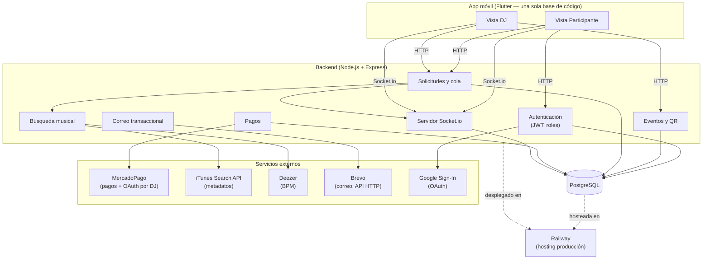

# Diagrama de arquitectura y componentes — BudSound

Regla de arquitectura: ninguna vista (Participante o DJ) accede directo a
la base de datos ni a una API externa — todo pasa por el backend, que
valida, autentica y orquesta cada integración.

## Componentes y su responsabilidad

| Componente | Responsabilidad |
|---|---|
| Vista Participante / Vista DJ (Flutter) | Interfaz por rol; nunca habla directo con la base de datos ni con un servicio externo. |
| Autenticación | Registro, login (correo o Google), verificación de correo, JWT. |
| Eventos y QR | Crear/cerrar eventos, garantizar un solo evento activo por DJ, código para el QR. |
| Solicitudes y cola | Validar y guardar solicitudes, mantener el orden de llegada, aplicar el límite anti-spam. |
| Pagos | Vincular MercadoPago del DJ (OAuth), autorizar, capturar y cancelar pagos. |
| Búsqueda musical | Metadatos de iTunes Search API y BPM de Deezer. |
| Correo transaccional | Verificación de cuenta y recuperación de contraseña vía Brevo. |
| Servidor Socket.io | Emite en tiempo real la cola nueva (DJ) y los cambios de estado (Participante). |
| PostgreSQL | Única base de datos; solo el backend se conecta a ella. |
