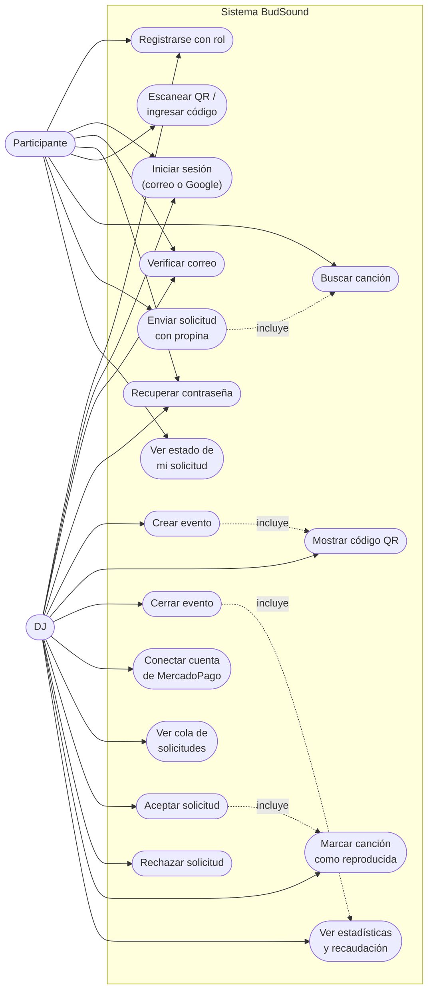

# Diagrama de casos de uso — BudSound

Mermaid no tiene un tipo de diagrama UML de casos de uso nativo; se
representa con un flowchart: los actores fuera del recuadro del sistema,
los casos de uso como nodos redondeados dentro de él.

## Descripción breve de los casos de uso principales

| Caso de uso | Actor | Descripción |
|---|---|---|
| Enviar solicitud con propina | Participante | Busca una canción y la envía al DJ con una propina obligatoria ($500–$20.000 CLP). El pago se reserva, no se cobra todavía. |
| Ver cola de solicitudes | DJ | Ve las solicitudes pendientes de su evento activo, en orden de llegada, con un plazo de 7 minutos para responder cada una. |
| Aceptar solicitud | DJ | Marca la solicitud como aceptada; se captura (cobra) la propina reservada. |
| Rechazar solicitud | DJ | Marca la solicitud como rechazada; se libera la propina reservada, sin cobrar nada. |
| Conectar cuenta de MercadoPago | DJ | Autoriza a BudSound (OAuth) para que las propinas de sus eventos se cobren directo en su propia cuenta. |
