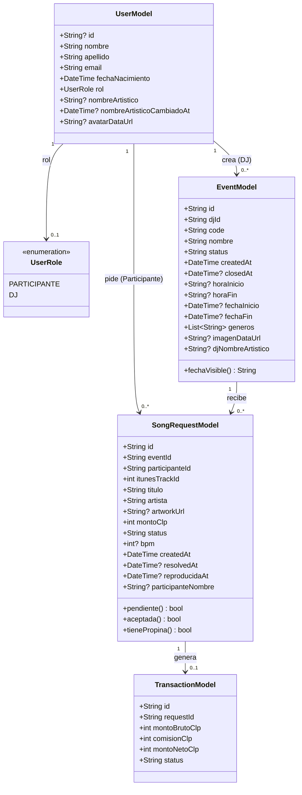

# Diagrama de clases — modelos de dominio (Flutter)

Clases de datos (`lib/models/`) que la app Flutter usa para representar lo
que recibe del backend. No son clases de negocio con lógica propia (eso
vive en los `services/` y en el backend) — son el espejo tipado de las
filas de `schema.sql` en el lado de la app.

