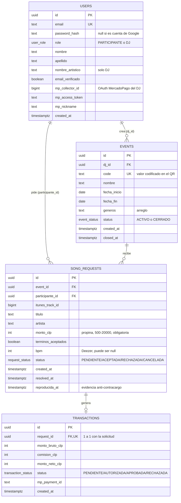

# Modelo de datos (ER) — BudSound

PostgreSQL, modelo relacional. Fuente real:
[`budsound_backend/src/db/schema.sql`](../../budsound_backend/src/db/schema.sql).

## Notas

- `users.role` distingue PARTICIPANTE de DJ dentro de la misma tabla — es
  una sola aplicación con dos roles, no dos esquemas separados.
- `transactions` tiene una relación 1 a 1 (no 1 a N) con `song_requests`:
  una solicitud nunca genera más de una transacción, por eso
  `request_id` es `UNIQUE`.
- Las claves foráneas usan `ON DELETE CASCADE`: borrar un usuario borra
  sus eventos/solicitudes; borrar un evento borra sus solicitudes; borrar
  una solicitud borra su transacción.
