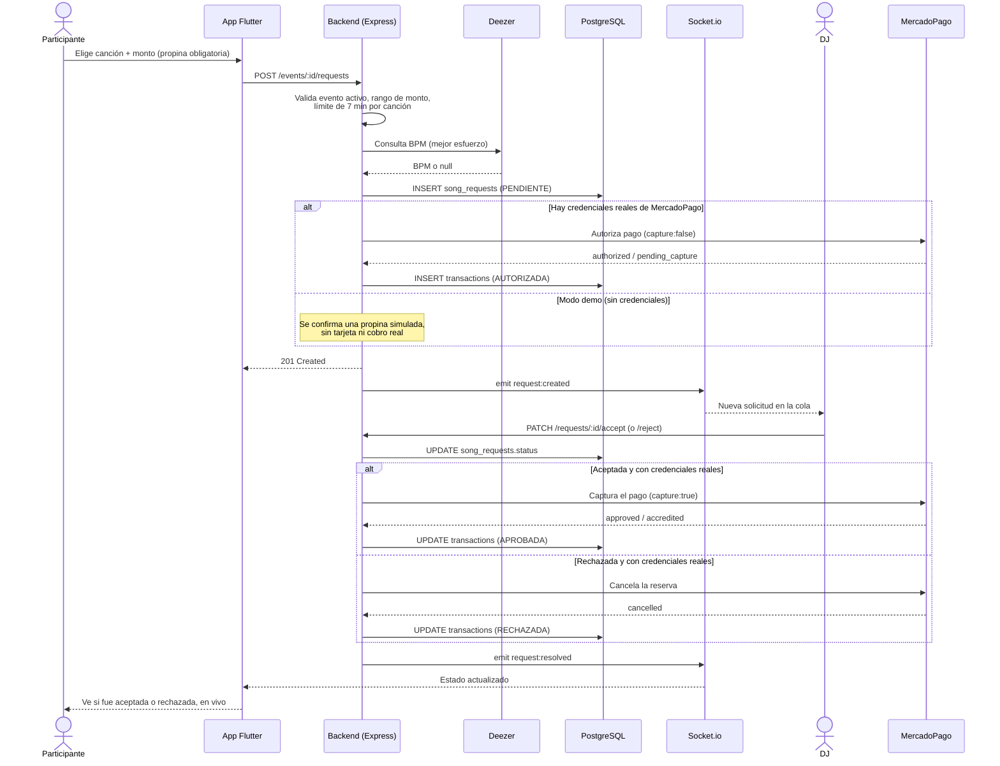
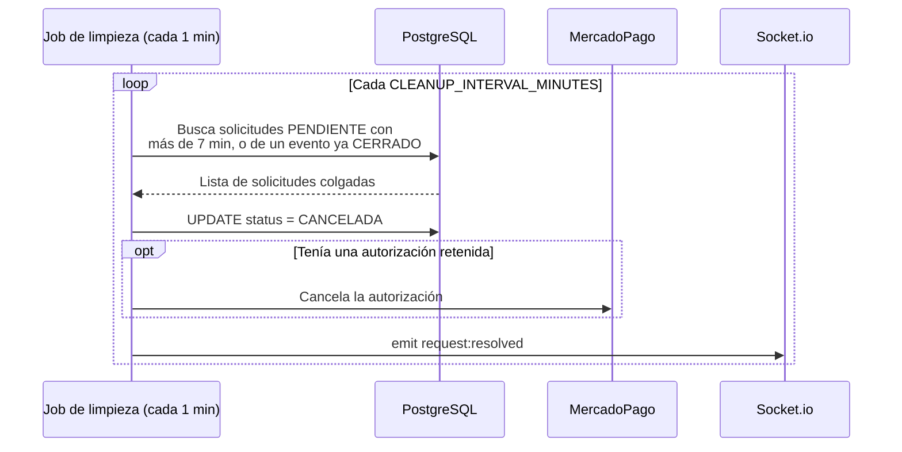

# Diagrama de secuencia — enviar y resolver una solicitud de canción

La funcionalidad principal del sistema: desde que el Participante envía
una solicitud hasta que ve el resultado, pasando por la cola en vivo del
DJ y el cobro condicionado de la propina.

## Caso alternativo: el DJ no responde a tiempo

